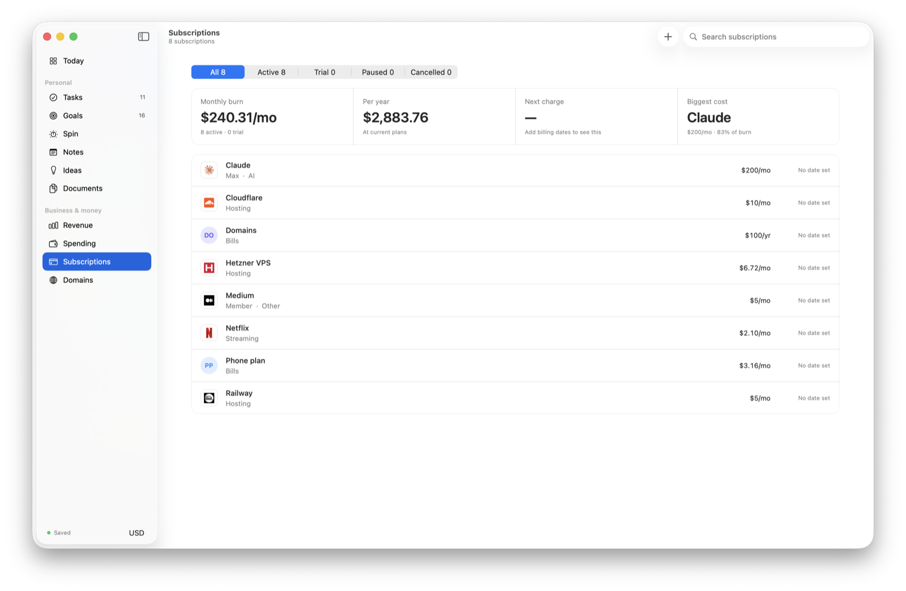

# Devtaskspace

One place to run your life and your products: tasks, goals and habits, a spin wheel that picks what to work on next, notes, documents, revenue, spending, subscriptions and domains. It runs locally on your Mac, and Claude can read and update it for you.



## Features

| Section | What it does |
| --- | --- |
| Today | Due and overdue tasks, renewals and a daily snapshot |
| Tasks | Quick add with natural dates (“fri”, “in 3d”), priorities, repeats, subtasks, tags |
| Goals | Goals with a number to reach, plus daily habits and promises with streaks |
| Spin | A wheel of today's habits and to-dos. Spin, do what it lands on, tick it off. Habits come back tomorrow, to-dos finish for good, Undo if you change your mind |
| Notes | Notes and a daily journal that saves as you type |
| Ideas | Weekend plans, app, article and video ideas |
| Documents | A vault for IDs, contracts and invoices, with expiry reminders |
| Revenue | Income by product, with automatic Dodo Payments sync |
| Spending | Monthly spending you log by hand |
| Subscriptions | Monthly and yearly burn, next charge, biggest cost |
| Domains | Expiry dates, registrars, renewal costs and whether each site is live |

There's also a menu bar icon with your due-task count, a dock badge and keyboard shortcuts (⌘1–⌘9 for sections, ⌘N for new).

## How it works

```text
server.js          Node 22+ server on localhost:4777, built-in SQLite, no npm install
mcp.js             MCP server: Claude can list, add, update and delete records
mac/Sources/       Native SwiftUI app (a client of the local server)
public/index.html  The original web version, served at http://localhost:4777
setup.sh           One-time setup: starts the server at login, connects Claude
```

- **Your data stays on your Mac.** Everything lives in `data/anashq.db`, which is gitignored along with keys, logs and the documents vault.
- **Nothing gets lost.** Every change, whether from you or Claude, is written to a `history` table with before and after values, and a full JSON backup runs every 6 hours.
- **Live updates.** The app listens for server events, so changes made from Claude appear right away.

## Setup

Needs macOS 14+, Node 22+ and the Xcode command line tools.

```bash
git clone https://github.com/mdanassaif/devtaskspace.git
cd devtaskspace
bash setup.sh        # starts the server at login, registers the MCP server with Claude
bash mac/build.sh    # builds the Mac app into ~/Applications
```

Optional: put `DODO_API_KEY=...` in `data/.env` to sync revenue from Dodo Payments every 15 minutes.

| Command | What it does |
| --- | --- |
| `launchctl kickstart -k gui/$(id -u)/com.anashq.server` | Restart the server |
| `launchctl bootout gui/$(id -u)/com.anashq.server` | Stop it for good |
| `data/server.log` | Server log |

## Using it from Claude

After `setup.sh`, Claude Code and the Claude desktop app get these tools: `hq_overview`, `hq_list`, `hq_add`, `hq_update`, `hq_delete`, `hq_history`.

Just ask, for example:

- “Add a task to renew my domain on Friday, high priority”
- “What renews this month?”
- “Add a daily habit: read for 20 minutes”

## Web version (Next.js)

The repo also contains the earlier hosted version in `src/` and `server/`: Next.js 14, Supabase sync, Resend email alerts and signed cookie auth.

```bash
npm install
cp .env.example .env.local   # fill in AUTH_*, RESEND_*, SUPABASE_* values
npm run dev                  # http://localhost:3000
```

For the database, create a Supabase project and run `server/supabase/schema.sql`. Run `npm run check` for type checks, lint and build. See [CONTRIBUTING.md](CONTRIBUTING.md) to contribute.
